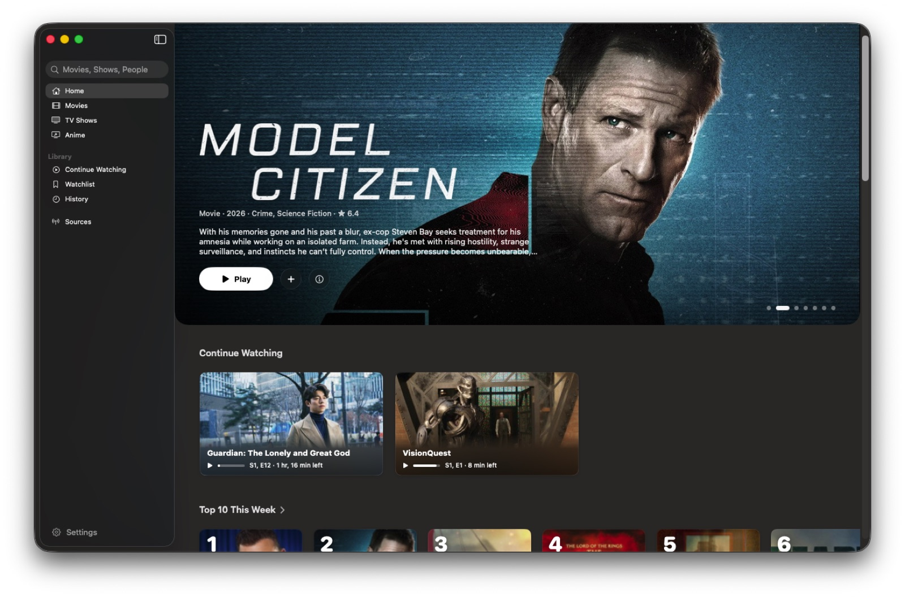
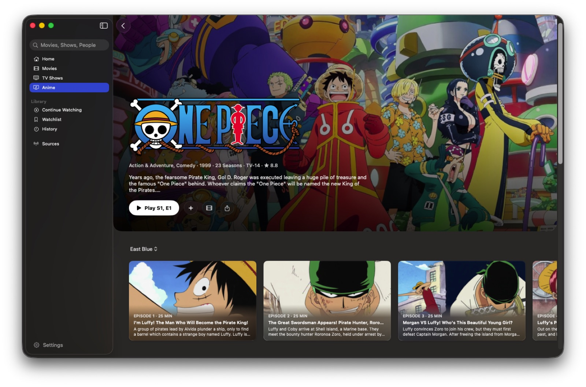
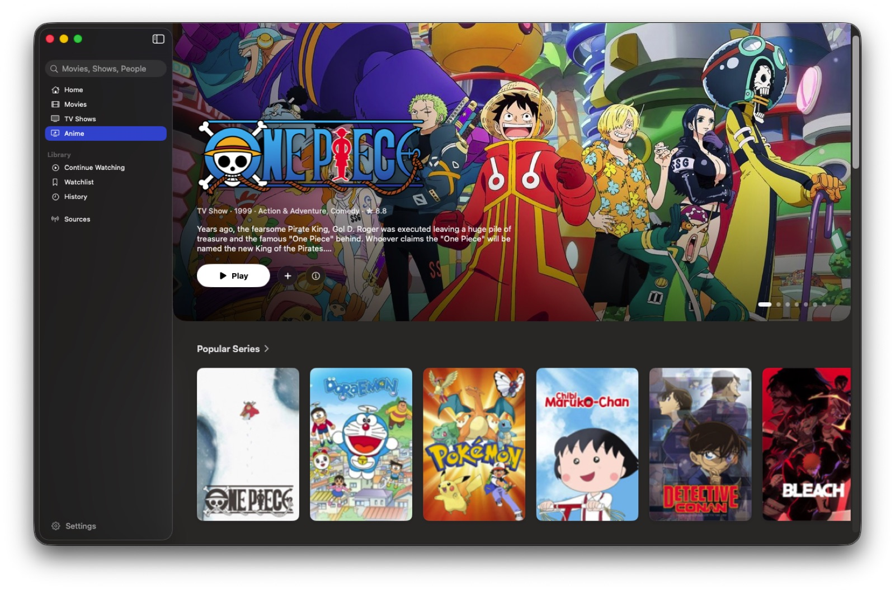

<div align="center">


# OpenStream for Mac

**Movies, series and anime in a native Mac app.**

Browse what's trending, pick up where you left off, and watch in Apple's own player:
Picture in Picture, AirPlay, subtitles, audio languages and full screen.


[](LICENSE)

</div>

<p align="center">
  
  
</p>
<p align="center">
  
</p>

OpenStream for Mac is the Apple sibling of [OpenStream for Android](https://github.com/Ivorisnoob/OpenStream), built for the Mac in SwiftUI rather than ported to it. It shares Android's source catalog and ideas, not its design.

## Features

**Discover**
- Home, Movies, TV Shows and Anime, each with featured titles and shelves of what's trending, popular, new and top rated
- Title pages with seasons and episodes, cast and crew, trailers, and more like it
- Search as you type, for films, series and people, with genres to browse

**Watch**
- Apple's player in its own window: Picture in Picture, AirPlay, full screen, speed, media keys and Now Playing
- Every enabled source searched at once, the best stream first; a stream that fails hands over to the next at the same spot
- The source that last played a title is asked first next time
- Subtitles from OpenSubtitles and the sources, with size, colour and background of your choosing
- Audio languages: the stream's own tracks, and other languages found across sources (anime sub and dub)
- Skip Intro and Skip Recap for anime, and the next episode lined up when the credits roll
- DASH streams play too, rewritten as HLS on the Mac

**Keep track**
- Continue Watching, Watchlist and History
- Back up your library to a file and restore it on another Mac

## Download

Download `OpenStream.dmg` from [Releases](../../releases/latest), open it and drag OpenStream into Applications. It needs macOS 26 or later and runs on Apple silicon and Intel.

OpenStream isn't notarized by Apple, so the first time macOS says it can't check it. Open **System Settings → Privacy & Security**, scroll down and click **Open Anyway**. Or, in Terminal:

```sh
xattr -dr com.apple.quarantine /Applications/OpenStream.app
```

## Building

Needs Xcode 26 and a free [TMDB API key](https://www.themoviedb.org/settings/api).

1. Copy `Config/Secrets.example.xcconfig` to `Config/Secrets.xcconfig` and put your key in it. That file stays out of git.
2. Open `OpenStream.xcodeproj` and run the **OpenStreamMac** scheme, or:

```sh
xcodebuild -project OpenStream.xcodeproj -scheme OpenStreamMac -configuration Debug \
  -destination 'platform=macOS' -derivedDataPath build/debug build
```

Tests for everything below the interface live in the `OpenStreamCore` package:

```sh
cd OpenStreamCore && swift test
```

`CLAUDE.md` maps the code: where everything lives, how each feature works, and why.

## Contributing

Issues and pull requests are welcome; see [CONTRIBUTING.md](CONTRIBUTING.md). Sources live in the shared catalog in the [Android repository](https://github.com/Ivorisnoob/OpenStream/tree/main/extensions), so a new or fixed source helps both apps.

## Disclaimer

OpenStream doesn't host, upload or store any video. It finds streams that third-party sites and add-ons publish, the way a web browser would, and plays them. Whether those streams are lawful where you live is for you to decide; use it for content you have the right to watch.

## Credits

- Film and series information and images from [TMDB](https://www.themoviedb.org). *This product uses the TMDB API but is not endorsed or certified by TMDB.*
- Subtitles from [OpenSubtitles](https://www.opensubtitles.org); anime episode mapping from [ani.zip](https://api.ani.zip) and [AniList](https://anilist.co); skip times from [AniSkip](https://aniskip.com).

## License

OpenStream for Mac is free software under the [GNU General Public License v3.0](LICENSE).
